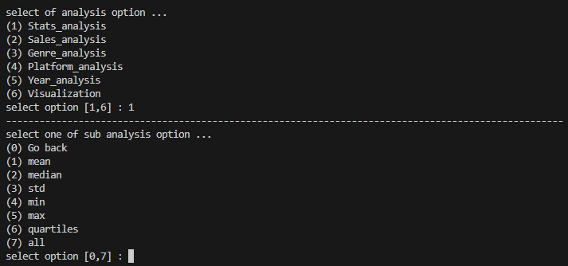
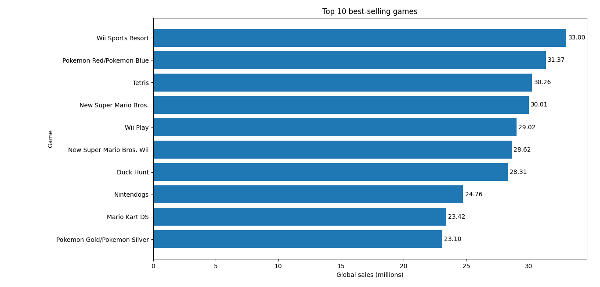
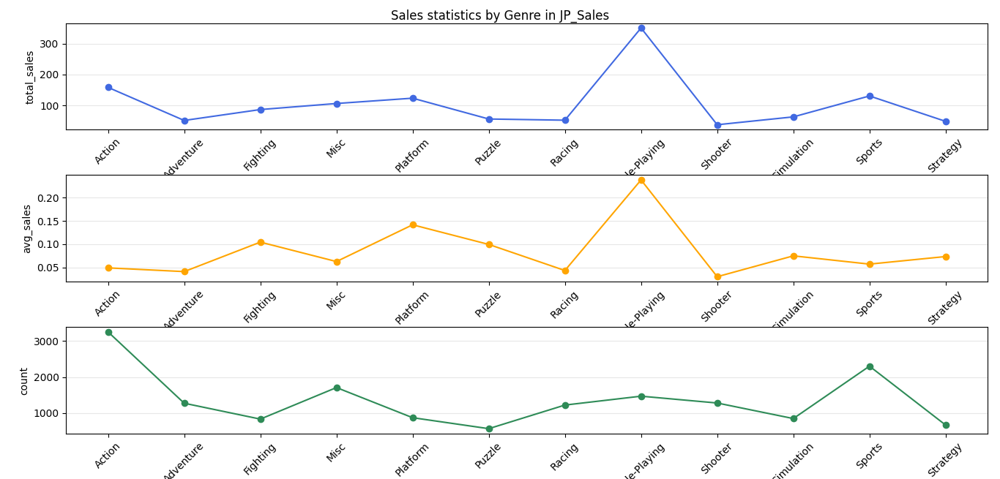

# 🎮 Video Game Analytics

A Python project for analyzing and visualizing video game sales data using Pandas, NumPy, and Matplotlib.

## ✨ Features

* 📂 Load Datasets (CSV, JSON, and Excel)
* 🧹 Data Cleaning and Preprocessing
* 📊 Descriptive Statistics
* 💰 Top 10 Best-Selling Games
* 📈 Sales Analysis and Average Comparison
* 🌍 Regional Sales Comparison
* 🎯 Genre and Platform Analysis
* 📅 Yearly Sales Trend Analysis
* 📉 Data Visualization

## 🛠️ Technologies

* `Python`
* `Pandas`
* `Matplotlib`

## 📁 Project Structure

```text
video-game-analytics-py/
├── analysis/
├── data/
│   ├── raw/
│   ├── prepared/
│   ├── data.py
│   ├── loader.py
│   └── prepare.py
├── tools/
├── visualization/
├── main.py
└── requirements.txt
```
## 🖼️ Screenshots

### Main Menu


### Top Selling games in global


### Sales statistics by genre


## 🚀 Run

```bash
git clone https://github.com/Amirho3ein-Rezaie/video-game-analytics-py.git
cd video-game-analytics-py
pip install -r requirements.txt
python main.py
```

## 🎯 Purpose

This project was created to practice Python programming and explore data analysis, data preprocessing, and visualization through a real-world dataset.

---
